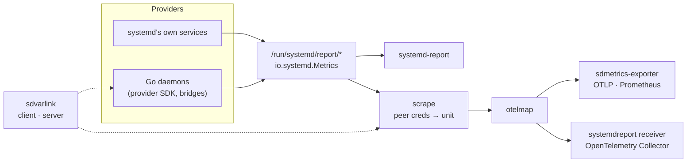

<p align="center">
  <a href="https://rossedman.github.io/sdmetrics/">
    
  </a>
</p>

<p align="center">
  <a href="https://github.com/rossedman/sdmetrics/actions/workflows/ci.yml"></a>
  <a href="https://github.com/rossedman/sdmetrics/actions/workflows/integration.yml"></a>
  <a href="https://pkg.go.dev/github.com/rossedman/sdmetrics"></a>
  <a href="https://goreportcard.com/report/github.com/rossedman/sdmetrics"></a>
  <a href="LICENSE"></a>
  <a href="https://rossedman.github.io/sdmetrics/"></a>
</p>

**sdmetrics** connects Go and OpenTelemetry to systemd's metrics framework
(systemd v260+). It has two halves:

- a **provider SDK** that lets any Go daemon publish metrics the way
  systemd's own services do, so `systemd-report` and every other consumer
  can read them;
- a **bridge** that collects every report source on a host and exports it
  as OpenTelemetry, as a standalone exporter or as an OpenTelemetry
  Collector receiver.

```go
p, err := provider.New("io.example.Queue") // socket: /run/systemd/report/io.example.Queue
if err != nil {
    return err
}
depth := p.Gauge("Depth", provider.Help("Jobs waiting"))
jobs := p.Counter("JobsProcessed", provider.Labels("result"))

go p.Serve(ctx) // stops and removes the socket when ctx ends

depth.Set(42)
jobs.With("ok").Inc()
```

```console
$ systemd-report metrics io.example.Queue
FAMILY                          OBJECT FIELDS          VALUE
io.example.Queue.Depth          -      -               42
io.example.Queue.JobsProcessed  -      {"result":"ok"} 1
```

## Why

systemd v260 added a metrics framework: any process becomes a metrics
source by binding a Unix socket under `/run/systemd/report/` and answering
the `io.systemd.Metrics` Varlink interface. `systemd-report` walks that
directory and gathers the results, and systemd's own services (the
manager, networkd, journald and, from v262, basic host, cgroup and file
system sources) publish there.

Two pieces were missing:

|  | |
| --- | --- |
| **No Go library publishes `io.systemd.Metrics`** | Go daemons had to hand-roll Varlink to join. `provider` does it in a few lines, with lock-free, allocation-free updates. |
| **Nothing exports report metrics as OTLP** | `sdmetrics-exporter` and the `systemdreport` Collector receiver turn every source on a host into OpenTelemetry metrics with correct types and units, each source a resource identified by its systemd unit. |

## What ships

| Component | What it is |
| --- | --- |
| [`provider`](https://pkg.go.dev/github.com/rossedman/sdmetrics/provider) | Serve metrics on a report socket: gauges, counters, strings, labels, objects, callback metrics, socket activation. |
| [`provider/prombridge`](https://pkg.go.dev/github.com/rossedman/sdmetrics/provider/prombridge), [`provider/otelbridge`](https://pkg.go.dev/github.com/rossedman/sdmetrics/provider/otelbridge) | Publish an existing Prometheus registry or OpenTelemetry SDK reader without re-instrumenting. |
| [`scrape`](https://pkg.go.dev/github.com/rossedman/sdmetrics/scrape) | Discover and scrape every source concurrently, with per-source timeouts, and resolve the unit behind each socket. |
| [`otelmap`](https://pkg.go.dev/github.com/rossedman/sdmetrics/otelmap) | Map systemd metric families to OpenTelemetry: types, resource attributes, counter start times, naming. |
| [`sdmetrics-exporter`](cmd/sdmetrics-exporter) | One static binary and a hardened systemd unit: OTLP push over gRPC or HTTP, optional Prometheus `/metrics`. |
| [`systemdreportreceiver`](receiver/systemdreportreceiver) | An OpenTelemetry Collector receiver (`systemdreport`) for fleets that already run otelcol. |

All of it builds on [sdvarlink](https://github.com/rossedman/sdvarlink) for
the Varlink layer: its generated `io.systemd.Metrics` client for scraping
and its `varlink.Server` for the provider.

## Install

```sh
go get github.com/rossedman/sdmetrics@latest                       # the libraries
go install github.com/rossedman/sdmetrics/cmd/sdmetrics-exporter@latest
```

Releases also ship `sdmetrics-exporter` as archives and as `.deb` and
`.rpm` packages that install the unit, see
[Releases](https://github.com/rossedman/sdmetrics/releases).

| Requirement | Supported |
| --- | --- |
| systemd | v260 or newer. On older hosts the exporter logs once and exits cleanly; the receiver reports no sources. |
| Go | The two newest releases (1.26 and 1.27). |
| OS | Linux, amd64 and arm64. Pure Go, no cgo, static binaries. |
| Collector | The receiver tracks the contrib release cadence (currently v0.163.0 / v1.69.0). |

## Export a host

```sh
# Push to an OTLP endpoint …
sdmetrics-exporter -otlp.endpoint otel-gateway.internal:4317
# … serve Prometheus …
sdmetrics-exporter -prometheus.listen :9558
# … or just look.
sdmetrics-exporter -once
```

```console
$ sdmetrics-exporter -once | head -4
SOURCE              UNIT                      FAMILY                                TYPE     OBJECT          FIELDS        VALUE
io.systemd.Manager  init.scope                io.systemd.Manager.NRestarts          counter  auditd.service  -             0
io.systemd.Manager  init.scope                io.systemd.Manager.UnitsByTypeTotal   gauge    -               type=service  92
io.systemd.Network  systemd-networkd.service  io.systemd.Network.OperationalState   string   eth0            -             "routable"
```

With a config file, as the packaged unit uses:

```yaml
interval: 30s
timeout: 2s
include: ["io.systemd.*", "io.example.*"]
otlp:
  endpoint: otel-gateway.internal:4317
  protocol: grpc
prometheus:
  listen: ""   # e.g. ":9558" to enable
resource:
  deployment.environment: prod
```

Or in a Collector:

```yaml
receivers:
  systemdreport:
    collection_interval: 30s
    include: ["io.systemd.*"]
service:
  pipelines:
    metrics:
      receivers: [systemdreport]
      exporters: [otlp]
```

## How it maps

| systemd type | OpenTelemetry |
| --- | --- |
| `gauge` | Gauge |
| `counter` | Sum, monotonic, cumulative; start time is the first observation, reset when the value drops or the process changes |
| `string` | Gauge = 1, the string in the `systemd.value` attribute |
| unknown (such as v262's `object`) | dropped and counted in `sdmetrics.metrics.dropped` |

Every source is a resource with `host.name`, `host.id`,
`systemd.report.source`, `systemd.unit.name`, `process.pid` and
`service.name`. The unit comes from the socket's peer credentials and
cgroup; for socket-activated sources, whose peer is PID 1, it comes from
the socket unit (systemd v262+). See the
[mapping reference](https://rossedman.github.io/sdmetrics/reference/mapping/).

## How it fits together



## Documentation

**[rossedman.github.io/sdmetrics](https://rossedman.github.io/sdmetrics/)**:
quickstarts, guides for the provider SDK, bridges, socket activation and
unit identity, the exporter and receiver configuration reference, and the
OpenTelemetry mapping. API docs are on
[pkg.go.dev](https://pkg.go.dev/github.com/rossedman/sdmetrics).

## Status

Pre-1.0. All four milestones of the initial plan (scraper and exporter,
provider SDK, bridges and Prometheus, Collector receiver) are in; the
receiver is alpha and the `systemd.*` attribute names are proposals. See
the [roadmap](https://rossedman.github.io/sdmetrics/project/roadmap/).

## Contributing

Issues and pull requests are welcome — see [CONTRIBUTING.md](CONTRIBUTING.md).

## License

[MIT](LICENSE).
