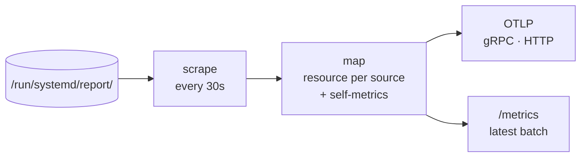

# sdmetrics-exporter

`sdmetrics-exporter` exports every systemd report source on a host as
OpenTelemetry metrics. On an interval it scrapes the sockets under
`/run/systemd/report/`, maps each source to a resource identified by its
unit, and delivers the batch:

- **OTLP push**, over gRPC or HTTP/protobuf, to a Collector or any OTLP
  backend;
- a **Prometheus endpoint**, `/metrics`, for pull-based setups;
- or both at once.



```sh
sdmetrics-exporter -config /etc/sdmetrics/exporter.yaml
sdmetrics-exporter -otlp.endpoint otel-gateway:4317 -otlp.insecure
sdmetrics-exporter -prometheus.listen :9558
sdmetrics-exporter -once            # print one scrape and exit
```

## Modes

`-once`
:   Scrape once, print every value with its source and unit, and exit. Use
    `-format json` for tools. Needs no outputs configured; ideal for checking
    a host, or a provider during development (`-dir /tmp/report`).

Daemon (default)
:   Scrape every `interval`, deliver, repeat until `SIGINT` or `SIGTERM`. At
    least one output must be configured: `otlp.endpoint` (or
    `OTEL_EXPORTER_OTLP_ENDPOINT`) or `prometheus.listen`.

## Behaviour

| Situation | What happens |
| --- | --- |
| A source fails or times out | The rest of the batch is delivered. The failure shows in `sdmetrics.source.up` and in debug logs. |
| OTLP delivery fails | Logged once as `delivery failing`, then `delivery recovered` when it works again. Batches are not queued. |
| `/run/systemd/report/` missing at startup | Logs a warning ("this host needs systemd v260 or newer") and **exits 0**, so the unit doesn't restart in a loop. |
| A family has an unknown type, or a bad name or value | Dropped and counted in `sdmetrics.metrics.dropped`. |
| Configuration has an unknown key | Refused at startup: exit 2. |

| Exit code | Meaning |
| --- | --- |
| `0` | Stopped by a signal, `-once` succeeded, or the daemon found no report directory. |
| `1` | A runtime error: the Prometheus listener failed, or `-once` could not scrape (including a missing report directory). |
| `2` | Bad flags or configuration, or no output configured. |

## Outputs at a glance

| Output | Enable with | Details |
| --- | --- | --- |
| OTLP gRPC | `otlp.endpoint: host:4317` | Default protocol. TLS unless `otlp.insecure`. |
| OTLP HTTP/protobuf | `otlp.protocol: http/protobuf` | Endpoint as `host:4318` or a full URL. |
| Prometheus | `prometheus.listen: 127.0.0.1:9558` | Serves the latest batch at `prometheus.path` (`/metrics`), plus `/healthz`. See [Prometheus endpoint](prometheus.md). |

The standard `OTEL_EXPORTER_OTLP_*` environment variables work too, for
example `OTEL_EXPORTER_OTLP_ENDPOINT` and `OTEL_EXPORTER_OTLP_HEADERS`; values
in the configuration file take precedence.

## Pages in this section

<div class="grid cards" markdown>

-   :material-cog-outline:{ .lg .middle } **[Configuration reference](configuration.md)**

    ---

    Every YAML key and flag, with defaults and validation rules.

-   :material-shield-lock-outline:{ .lg .middle } **[Running under systemd](systemd.md)**

    ---

    The hardened unit, the `sdmetrics` group, restricted sources and
    drop-ins.

-   :simple-prometheus:{ .lg .middle } **[Prometheus endpoint](prometheus.md)**

    ---

    Names, labels, `/healthz` and a scrape job.

-   :material-heart-pulse:{ .lg .middle } **[Self-metrics](self-metrics.md)**

    ---

    Watching the exporter: source health, drops and alert rules.

</div>
