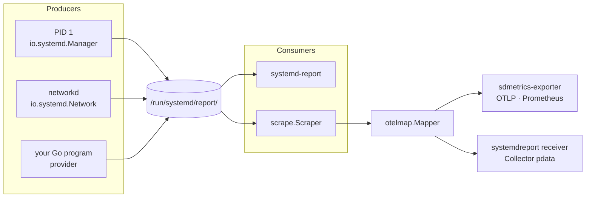

# Core concepts

systemd v260 added a **report framework** for metrics. A service publishes
metrics by serving the `io.systemd.Metrics` Varlink interface on a Unix socket
under `/run/systemd/report/`. A consumer lists that directory, calls every
socket, and gets typed metric families back. There is no registry, no port
and no push: the directory *is* the inventory.

That paragraph is the whole model. This page walks through each piece and
shows where it surfaces in sdmetrics.

## Sources

A **source** is a socket in the report directory, named like a Varlink
interface:

| Directory | Who reads it |
| --- | --- |
| `/run/systemd/report/` | System-wide sources. `systemd-report`, `sdmetrics-exporter`, the `systemdreport` receiver. |
| `$XDG_RUNTIME_DIR/systemd/report/` | Per-user sources. `systemd-report --user`. |

Source names follow the Varlink interface rules, reverse-domain style:
`io.systemd.Manager`, `io.systemd.Network`, `io.example.Queue`. Entries that
are not sockets (or symlinks to sockets), or whose names are not valid
interface names, are ignored, by systemd and by sdmetrics alike.

systemd ships its own sources. In v260 PID 1 serves `io.systemd.Manager` and
daemons such as networkd serve theirs. v262 adds `io.systemd.Basic`,
`io.systemd.CGroup`, `io.systemd.Files`, `io.systemd.Journal` and
`io.systemd.Report.SignPlain`, and socket-activates most of its sources
through units such as `systemd-report-basic.socket`.

In sdmetrics, `provider.New("io.example.Queue")` creates a source;
`scrape.Scraper` reads all of them.

## The interface

`io.systemd.Metrics` has two methods, both streaming (`more`):

```text title="io.systemd.Metrics (v260 IDL, abridged)"
method List() -> (name: string, object: ?string, fields: ?object, value: any)
method Describe() -> (name: string, description: string, type: MetricFamilyType)
error NoSuchMetric()
```

`Describe`
:   One reply per **family**: its name, a description and a type.

`List`
:   One reply per **value**: the family name, an optional object, optional
    fields, and the value.

A source with nothing to report answers `io.systemd.Metrics.NoSuchMetric`
instead of an empty stream, as systemd's own sources do. sdmetrics providers
do the same, and the scraper treats it as "no families", not an error.

Here is a `List` call to a provider, as the wire carries it:

```text
→ {"method":"io.systemd.Metrics.List","parameters":{},"more":true}\0
← {"parameters":{"name":"io.example.Queue.Depth","value":42},"continues":true}\0
← {"parameters":{"name":"io.example.Queue.JobsProcessed","fields":{"result":"ok"},"value":3}}\0
```

## Families and names

A **family** is a named set of values of one type. Its name is the source
name, a dot, and a field name:

```text
io.systemd.Manager.UnitsByTypeTotal
└───── source ────┘└── field name ──┘
```

`systemd-report` **drops families not named after the socket they came
from**, so `io.example.Queue` can only publish `io.example.Queue.*`. The field
part is a Varlink field name: a letter, then letters, digits and single
underscores. systemd's own families use PascalCase (`NRestarts`,
`UnitActiveState`).

The provider enforces these rules when you register a metric, and panics on a
name systemd would drop. The scraper applies the same rules when reading. All
of them are in [systemd naming rules](../reference/naming.md).

## Types and values

v260 defines three family types:

| Type | Values | Example | OpenTelemetry |
| --- | --- | --- | --- |
| <span class="sd-type sd-type--counter">counter</span> | Numbers that only go up | `io.systemd.Manager.NRestarts` | Monotonic cumulative Sum |
| <span class="sd-type sd-type--gauge">gauge</span> | Numbers that go up and down | `io.systemd.Manager.UnitsByTypeTotal` | Gauge |
| <span class="sd-type sd-type--string">string</span> | Strings, such as a state | `io.systemd.Manager.UnitActiveState` | Gauge of `1`, the string in `systemd.value` |

Values are JSON numbers or strings. systemd's own counters send unsigned
integers; sdmetrics keeps integers as integers and everything else as
`float64`.

!!! warning "The `object` type (systemd v262)"

    systemd v262 adds a fourth type, `object`, whose values are JSON objects;
    journald uses it. sdmetrics does not map it yet: those families are
    dropped and counted in `sdmetrics.metrics.dropped{reason="untyped"}`. See
    the [roadmap](../project/roadmap.md#follow-ups).

## Fields and objects

A value can carry two kinds of context:

`fields`
:   A JSON object of string values that tell the values of a family apart,
    like Prometheus labels: `{"type":"service"}`. In the provider they are
    `Labels`, set with `With`. In OpenTelemetry they become point attributes.

`object`
:   One string naming **what the value is about**: a unit, a device, an
    interface. `io.systemd.Manager.NRestarts` has one value per unit, with the
    unit name as its object. In the provider it is `On`. In OpenTelemetry it
    becomes the `systemd.object` point attribute.

```json
{"name":"io.systemd.Manager.NRestarts","object":"systemd-networkd.service","value":0}
{"name":"io.systemd.Manager.UnitsByTypeTotal","fields":{"type":"service"},"value":142}
```

## Identity

A source's socket has **peer credentials**: the PID, UID and GID of the
process that created it. The scraper reads them with `SO_PEERCRED`, reads
`/proc/<pid>/cgroup`, and takes the innermost unit in the path. That is how a
metric knows it came from `systemd-networkd.service` without the service
saying so.

Socket-activated sources are created by PID 1, so their peer is PID 1. For
those, the scraper asks the service manager which socket unit listens on the
path. The details, and what happens on older systemd, are in
[Unit identity](../guides/unit-identity.md).

## How the pieces fit



| Concept | systemd | sdmetrics | OpenTelemetry |
| --- | --- | --- | --- |
| Source | socket in `/run/systemd/report/` | `provider.Provider`, `scrape.Source` | Resource |
| Owner | the unit behind the socket | `Source.Unit` | `systemd.unit.name`, `service.name` |
| Family | `Describe` reply | `scrape.Family` | Metric |
| Value | `List` reply | `scrape.Metric` | Data point |
| Fields | `fields` | `provider.Labels`, `Metric.Fields` | Point attributes |
| Object | `object` | `On`, `Metric.Object` | `systemd.object` |

Next: the [Provider SDK](../guides/provider.md), or the full
[OpenTelemetry mapping](../reference/otel-mapping.md).
