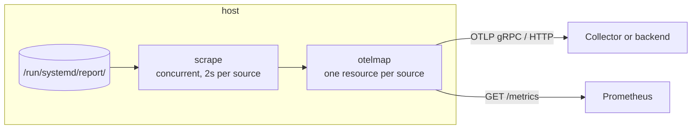

# Quickstart: export a host

In five minutes you'll list every report source on a systemd v260+ host,
serve them to Prometheus, and push them to an OpenTelemetry Collector. You
need root on the host and the exporter
[installed](installation.md#the-exporter).

## 1. Look before you export

`-once` scrapes every source, prints the result and exits. It needs no
configuration:

```sh
sdmetrics-exporter -once
```

```text title="Output on a systemd v262 host (illustrative, trimmed)"
SOURCE              UNIT                      FAMILY                                TYPE     OBJECT                    FIELDS        VALUE
io.systemd.Manager  init.scope                io.systemd.Manager.UnitsByTypeTotal   gauge    -                         type=service  142
io.systemd.Manager  init.scope                io.systemd.Manager.NRestarts          counter  systemd-networkd.service  -             0
io.systemd.Manager  init.scope                io.systemd.Manager.UnitActiveState    string   systemd-networkd.service  -             "active"
io.systemd.Network  systemd-networkd.service  io.systemd.Network.ManagedInterfaces  gauge    -                         -             2
...

9 sources, 1874 values in 26.9ms.
```

Each row is one value. `UNIT` is the systemd unit that owns the source:
`init.scope` is PID 1. Use `-format json` for a machine-readable dump, and
`-include 'io.systemd.*'` or `-exclude` to filter sources.

## 2. Serve Prometheus

The packaged configuration, `/etc/sdmetrics/exporter.yaml`, already serves
Prometheus on `127.0.0.1:9558`. Start the service:

```sh
sudo systemctl enable --now sdmetrics-exporter
curl -s 127.0.0.1:9558/metrics | grep -m3 io_systemd_Manager
```

```text title="Output (illustrative)"
# HELP io_systemd_Manager_UnitsByTypeTotal Number of units by type
# TYPE io_systemd_Manager_UnitsByTypeTotal gauge
io_systemd_Manager_UnitsByTypeTotal{service_name="systemd",systemd_report_source="io.systemd.Manager",systemd_unit_name="init.scope",type="service"} 142
```

Point a Prometheus scrape job at it, and see
[Prometheus endpoint](../exporter/prometheus.md) for the label rules.

## 3. Push OTLP

Edit the configuration with an endpoint, or set the standard
`OTEL_EXPORTER_OTLP_ENDPOINT` variable:

```yaml title="/etc/sdmetrics/exporter.yaml"
interval: 30s
naming: otel            # systemd.manager.units_by_type instead of io.systemd.Manager.UnitsByTypeTotal

otlp:
  endpoint: otel-gateway.internal:4317
  protocol: grpc
  insecure: true        # plaintext, for a collector on a private network

prometheus:
  listen: "127.0.0.1:9558"
```

```sh
sudo systemctl restart sdmetrics-exporter
journalctl -u sdmetrics-exporter -n 5
```

Each source arrives as its own OpenTelemetry **resource**, with
`systemd.unit.name` and a `service.name` derived from the unit:

| Source | `systemd.unit.name` | `service.name` |
| --- | --- | --- |
| `io.systemd.Manager` | `init.scope` | `systemd` |
| `io.systemd.Network` | `systemd-networkd.service` | `systemd-networkd` |
| `io.example.Queue` | `queued.service` | `queued` |

## What just happened



1. Every `interval`, the exporter listed `/run/systemd/report/` and called each
   socket's `io.systemd.Metrics`, eight at a time, with a 2 s timeout each.
2. It resolved each source's unit from the socket's peer credentials and
   `/proc/<pid>/cgroup`, asking the manager for socket-activated ones.
3. It mapped families to OpenTelemetry metrics, added its own
   [self-metrics](../exporter/self-metrics.md), then pushed and served the
   batch.

!!! tip "Stuck?"

    - **The service exits right away with "no report directory"**: the host's
      systemd is older than v260. This is deliberate, so the unit doesn't
      restart in a loop.
    - **A source shows `error: dial: ... permission denied`**: its socket is
      mode `0660` for a group the exporter isn't in. See
      [Running under systemd](../exporter/systemd.md#reading-restricted-sources).
    - **`UNIT` is `-` for a socket-activated daemon**: on systemd v260 and v261
      the manager can't say which unit owns the socket. Name it with
      [`units:`](../exporter/configuration.md#units).

## Where next

<div class="grid cards" markdown>

-   :material-cog-outline: **Every option**

    ---

    [:octicons-arrow-right-24: Configuration reference](../exporter/configuration.md)

-   :material-shield-lock-outline: **The hardened unit**

    ---

    [:octicons-arrow-right-24: Running under systemd](../exporter/systemd.md)

-   :material-transit-connection-variant: **Use the Collector instead**

    ---

    [:octicons-arrow-right-24: systemdreport receiver](../receiver/index.md)

</div>
