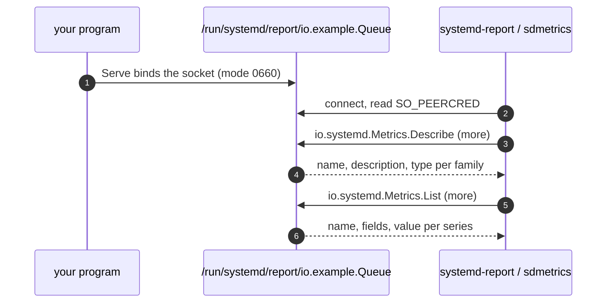

# Quickstart: publish metrics

In five minutes you'll publish a gauge and a labelled counter from a Go
program, read them with systemd's own `systemd-report`, and see them through
`sdmetrics-exporter`. You need Go 1.26+ and a Linux host. systemd v260+ is
needed only for the `systemd-report` step.

## 1. Create a module

```sh
mkdir queue && cd queue
go mod init example.com/queue
go get github.com/rossedman/sdmetrics@latest
```

## 2. Write the program

The provider part is ten lines: create it, register two metrics, update them,
serve.

```go title="main.go"
package main

import (
    "context"
    "flag"
    "log"
    "os"
    "os/signal"
    "time"

    "github.com/rossedman/sdmetrics/provider"
)

func main() {
    dir := flag.String("dir", provider.DefaultDir, "report directory") // (1)!
    flag.Parse()

    p, err := provider.New("io.example.Queue", provider.WithDir(*dir)) // (2)!
    if err != nil {
        log.Fatal(err)
    }
    depth := p.Gauge("Depth", provider.Help("Jobs waiting")) // (3)!
    jobs := p.Counter("JobsProcessed", provider.Help("Jobs finished"), provider.Labels("result"))

    ctx, stop := signal.NotifyContext(context.Background(), os.Interrupt)
    defer stop()
    go func() { // a stand-in for real work
        for ctx.Err() == nil {
            depth.Set(float64(time.Now().Second()))
            jobs.With("ok").Inc() // (4)!
            time.Sleep(time.Second)
        }
    }()

    log.Printf("publishing on %s", p.Path())
    if err := p.Serve(ctx); err != nil { // (5)!
        log.Fatal(err)
    }
}
```

1.  `/run/systemd/report` is where consumers look, and writing there needs
    root. `-dir /tmp/report` lets you try the program as any user.
2.  The provider name is a Varlink interface name in reverse-domain style. It
    becomes the socket's file name, and the prefix of every family.
3.  Registration validates names and panics on any name `systemd-report` would
    drop, so mistakes show up at startup.
4.  `With` takes one value per declared label. Keep the handle it returns on
    hot paths: `ok := jobs.With("ok")`.
5.  `Serve` binds the socket, answers `io.systemd.Metrics.List` and
    `Describe`, and removes the socket when the context ends.

## 3. Run it

```sh
go run . -dir /tmp/report
```

In a second terminal, read it back with the exporter's `-once` mode:

```sh
go run github.com/rossedman/sdmetrics/cmd/sdmetrics-exporter@latest -once -dir /tmp/report
```

```text title="Output (illustrative)"
SOURCE            UNIT               FAMILY                          TYPE     OBJECT  FIELDS     VALUE
io.example.Queue  user@1000.service  io.example.Queue.Depth          gauge    -       -          17
io.example.Queue  user@1000.service  io.example.Queue.JobsProcessed  counter  -       result=ok  17

1 sources, 2 values in 1.2ms.
```

The `UNIT` column is the unit your shell runs in: the scraper resolved it from
the socket's peer credentials. Run the program as a service and it shows that
service instead.

## 4. Read it with systemd

On a systemd v260+ host, run the program as root against the real directory,
and systemd's own tool can read it:

```sh
go build -o queue . && sudo ./queue
```

```sh
systemd-report metrics io.example.Queue
systemd-report describe io.example.Queue    # describe-metrics on v260 and v261
```

Or speak Varlink directly:

```sh
varlinkctl call --more /run/systemd/report/io.example.Queue io.systemd.Metrics.List '{}'
```

```json title="Output (illustrative)"
{"name":"io.example.Queue.Depth","value":17}
{"name":"io.example.Queue.JobsProcessed","fields":{"result":"ok"},"value":17}
```

## What just happened



1. `provider.New` checked the name and prepared the socket path; nothing was
   bound yet.
2. `Serve` bound the socket and served `io.systemd.Metrics` with sdvarlink's
   `varlink.Server`.
3. Consumers called `Describe` for types and `List` for values. Each value read
   the current atomic, so no lock was taken against your updates.

!!! tip "Stuck?"

    - **`permission denied` binding the socket**: `/run/systemd/report` needs
      root. Use `-dir /tmp/report`, or let systemd bind it with
      [socket activation](../guides/sockets.md).
    - **`systemd-report` doesn't list your metrics**: check the family names
      start with the socket's name. The provider guarantees this; a
      hand-written source might not. See [Naming rules](../reference/naming.md).
    - **The exporter can't read the socket**: the default mode is `0660`. See
      [Socket activation & permissions](../guides/sockets.md#permissions).

## Where next

<div class="grid cards" markdown>

-   :material-gauge: **The provider in depth**

    ---

    Every metric type and option, and how updates stay allocation-free.

    [:octicons-arrow-right-24: Provider SDK](../guides/provider.md)

-   :material-power-plug-outline: **Run it as a service**

    ---

    A `.socket` unit, `FromActivation`, and who may read the socket.

    [:octicons-arrow-right-24: Socket activation](../guides/sockets.md)

-   :material-bridge: **Already instrumented?**

    ---

    Publish a Prometheus registry or OTel reader without changes.

    [:octicons-arrow-right-24: Bridges](../guides/prometheus-bridge.md)

-   :material-folder-play-outline: **A fuller example**

    ---

    `examples/queued`: strings, objects, callbacks and unit files.

    [:octicons-arrow-right-24: Labels, objects & strings](../guides/labels-objects-strings.md)

</div>
