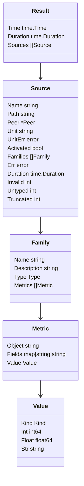

# Scraping from Go

The `scrape` package is the consumer side of the report framework: a small
`systemd-report` in Go. It lists the report directory, calls every source
concurrently with a per-source timeout, resolves the unit behind each socket,
and returns typed families. `sdmetrics-exporter` and the Collector receiver
are both built on it.

```go
s := scrape.New(scrape.Options{})
res, err := s.Scrape(ctx)
if err != nil {
    return err // the directory could not be read
}
for _, src := range res.Sources {
    if src.Err != nil {
        log.Printf("%s: %v", src.Name, src.Err) // one failing source never fails the batch
        continue
    }
    for _, f := range src.Families {
        fmt.Println(src.Unit, f.Name, f.Type, len(f.Metrics))
    }
}
```

## Options

The zero `Options` scrapes `/run/systemd/report` with sensible defaults.

| Field | Default | Meaning |
| --- | --- | --- |
| `Dir` | `/run/systemd/report` | The report directory. Per-user: `$XDG_RUNTIME_DIR/systemd/report`. |
| `Include` | all | Only sources matching one of these `path.Match` patterns, such as `io.systemd.*`. |
| `Exclude` | none | Skip sources matching one of these patterns. |
| `Concurrency` | 8 (`DefaultConcurrency`) | Sources called at once. |
| `Timeout` | 2 s (`DefaultTimeout`) | Time budget per source, for dial, `Describe` and `List`. |
| `MaxFrameSize` | 1 MiB (`DefaultMaxFrameSize`) | Largest single reply accepted. |
| `MaxMetrics` | 16,384 (`DefaultMaxMetrics`) | Values kept per source; the rest are counted in `Truncated`. |
| `ProcRoot` | `/proc` | Where `/proc` is mounted, for tests. |
| `Logger` | `slog.Default()` | Gets one warning per source, family and reason for dropped data. |
| `ManagerSocket` | `/run/systemd/io.systemd.Manager` | The manager asked about socket-activated sources. Per-user: `$XDG_RUNTIME_DIR/systemd/io.systemd.Manager`. |
| `NoActivationLookup` | `false` | Don't ask the manager. |

A `Scraper` is safe for concurrent use, and worth keeping: it caches the
manager's socket index and logs each kind of drop only once.

## Results



Sources are sorted by name; families come in the order `Describe` sent them.
A `Value` is one of three kinds:

| `Kind` | Holds | When |
| --- | --- | --- |
| `KindInt` | `Int` | Integers that fit `int64`, which is what systemd's counters send. |
| `KindFloat` | `Float` | Any other number, including integers beyond `int64`. |
| `KindString` | `Str` | Values of `string` families. |

`Value.Number()` returns a numeric value as `float64`, and `Value.String()`
formats any kind (strings quoted).

## Errors

`Scrape` returns an error only when the whole scrape can't happen:

| Error | Meaning |
| --- | --- |
| `scrape.ErrNoReportDir` | The directory does not exist: systemd is older than v260. |
| a pattern error | An `Include` or `Exclude` pattern is malformed. |
| any other | The directory could not be read. |

Everything else is **per source**, in `Source.Err`: a dial failure, a
timeout, a protocol error. `Families` then holds whatever arrived before the
error. A source answering `io.systemd.Metrics.NoSuchMetric` is not an error;
it just has no families.

## What gets dropped

The scraper applies `systemd-report`'s rules, and counts what breaks them on
the `Source`:

| Counter | Values dropped because |
| --- | --- |
| `Invalid` | The family is not named after its source, the value has the wrong kind for the family's type, or the fields are not a JSON object. |
| `Untyped` | `Describe` gave the family no known type. This includes systemd v262's `object` type. |
| `Truncated` | The source sent more than `MaxMetrics` values. |

Families that `Describe` reports with a bad name or an unknown type are
skipped outright. Each kind of drop is logged once per source and family.
The exporter and receiver turn these counts into
`sdmetrics.metrics.dropped`.

## Unit identity

Each source carries `Peer` (the socket's `SO_PEERCRED`), `Unit`, and, when the
unit is unknown, `UnitErr` saying why. `Activated` reports that PID 1 created
the socket. [Unit identity](unit-identity.md) explains the lookup and the
errors (`scrape.ErrActivated`, `scrape.ErrNoUnit`). `scrape.UnitFromCgroupPath`
and `scrape.UnitFromProcCgroup` are exported for reuse.

## Mapping to OpenTelemetry

`otelmap` turns a `scrape.Result` into a neutral `Batch`: one resource per
source plus one for self-metrics. `otelmap.ToSDK` converts a batch for the
OpenTelemetry Go SDK's exporters:

```go
package main

import (
    "context"
    "log"
    "time"

    "go.opentelemetry.io/otel/exporters/otlp/otlpmetric/otlpmetricgrpc"

    "github.com/rossedman/sdmetrics/otelmap"
    "github.com/rossedman/sdmetrics/scrape"
)

func main() {
    ctx := context.Background()
    exp, err := otlpmetricgrpc.New(ctx) // reads OTEL_EXPORTER_OTLP_* variables
    if err != nil {
        log.Fatal(err)
    }
    defer exp.Shutdown(ctx)

    s := scrape.New(scrape.Options{Include: []string{"io.systemd.*"}})
    m := otelmap.NewMapper(otelmap.Options{ // (1)!
        Naming:   otelmap.NamingOTel,
        Resource: map[string]string{"deployment.environment": "prod"},
    })

    for range time.Tick(30 * time.Second) {
        res, err := s.Scrape(ctx)
        if err != nil {
            log.Fatal(err)
        }
        for _, rm := range otelmap.ToSDK(m.Map(res), "v0.1.0") { // (2)!
            if err := exp.Export(ctx, rm); err != nil {
                log.Print(err)
            }
        }
    }
}
```

1.  Keep one `Mapper` per pipeline: it remembers counter start times and
    self-metric totals between scrapes.
2.  One `*metricdata.ResourceMetrics` per resource. The second argument is
    the instrumentation scope version.

This is, in essence, what `sdmetrics-exporter` does. The mapping itself is
specified in [OpenTelemetry mapping](../reference/otel-mapping.md).

## A complete example

`examples/scrape` prints each source's unit and families:

```go title="examples/scrape/main.go"
--8<-- "examples/scrape/main.go"
```

## Performance

Sources are called concurrently, so a scrape takes about as long as its
slowest source, not the sum. Measured with providers in one process: **50
sources with 5,000 values in about 27 ms**. `BenchmarkScrape200` (200 sources)
runs in CI against the base branch on every pull request.

Next: [Unit identity](unit-identity.md).
