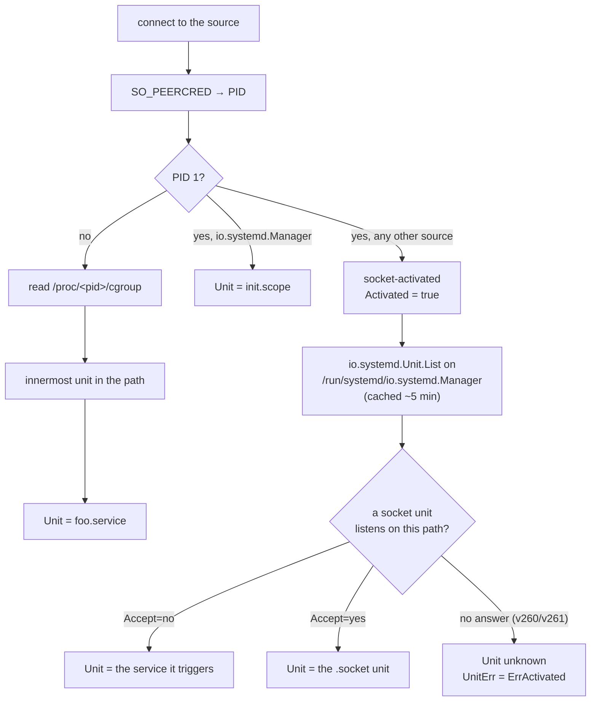

# Unit identity

A report source doesn't say who it is. sdmetrics works it out from the
socket itself, so every metric can be attributed to the unit that produced
it, as `systemd.unit.name` and a `service.name` derived from it.

## The lookup



### Peer credentials and cgroups

The scraper reads the socket's peer credentials with `SO_PEERCRED`: the PID,
UID and GID of the process that created the listening socket. It then reads
`/proc/<pid>/cgroup` and takes the **innermost unit** on the path:

| cgroup path | Unit |
| --- | --- |
| `/system.slice/systemd-networkd.service` | `systemd-networkd.service` |
| `/system.slice/foo.service/worker` | `foo.service` |
| `/user.slice/user-1000.slice/user@1000.service/app.slice/foo.service` | `foo.service` |
| `/init.scope` | `init.scope` |
| `/system.slice` | `system.slice` (a slice is used only when nothing more specific is found) |

The unit types recognized are `.service`, `.scope`, `.socket`, `.mount`,
`.swap`, `.device`, `.automount`, `.path` and `.timer`. The unified (cgroup v2)
`0::` line is preferred; the v1 `name=systemd` hierarchy is a fallback.

`scrape.UnitFromCgroupPath` and `scrape.UnitFromProcCgroup` expose these
rules.

## Socket-activated sources

When systemd socket-activates a source, PID 1 creates the listening socket,
so the peer is PID 1 for every activated source. Since v262, systemd
socket-activates most of its *own* sources too (`systemd-report-basic.socket`
and others, several with `Accept=yes`).

For those sources the scraper sets `Source.Activated` and asks the service
manager instead: it calls `io.systemd.Unit.List` on
`/run/systemd/io.systemd.Manager` and finds the socket unit whose `Listen=`
address is the source's path.

| Socket unit | Reported unit |
| --- | --- |
| `Accept=no` (one service for all connections) | The service it triggers, such as `queued.service`. |
| `Accept=yes` (one service instance per connection) | The `.socket` unit itself, such as `systemd-report-basic.socket`. |

Listing all units is about a megabyte on a typical host, so the index is
cached for about five minutes, and a source missing from it triggers a
refresh at most once a minute.

!!! warning "systemd v260 and v261"

    The socket units' `Listen=` addresses appear in `io.systemd.Unit.List`
    only from systemd **v262**. On v260 and v261 activated sources stay
    unresolved: `Unit` is empty and `UnitErr` matches `scrape.ErrActivated`.
    Name them in the configuration instead:

    === "sdmetrics-exporter"

        ```yaml
        units:
          io.example.Queue: queued.service
        ```

    === "systemdreport receiver"

        ```yaml
        receivers:
          systemdreport:
            units:
              io.example.Queue: queued.service
        ```

    `units` sets `systemd.unit.name` (and so `service.name`) for that source.
    It wins over what the scraper found.

## When the unit can't be resolved

The scraper never fails a source over identity. It records why in
`Source.UnitErr`, and the mapper records it in the
`sdmetrics.source.unit.resolved` self-metric, `0` with a `reason`:

| `reason` | Cause | Fix |
| --- | --- | --- |
| `activated` | Socket-activated, and the manager didn't say who owns the socket (systemd < v262, or the lookup failed). | Upgrade to v262, or set `units`. |
| `proc_unreadable` | `/proc/<pid>/cgroup` can't be read: `hidepid=` on `/proc`, or `ProtectProc=invisible` on the scraper's unit. | Let the scraper see `/proc` (the packaged unit keeps `ProtectProc=default`), or set `units`. |
| `no_unit` | The process isn't in a systemd unit, for example in a container's own cgroup tree. | Set `units`, or accept the source name as `service.name`. |
| `peer_unavailable` | Peer credentials couldn't be read. | — |
| `scrape_failed` | The source couldn't be scraped at all. | See `sdmetrics.source.up`. |

Without a unit, `service.name` falls back to the source name, so data is
never unattributed, only less specific.

## From unit to `service.name`

| Unit | `service.name` |
| --- | --- |
| `init.scope` | `systemd` |
| `systemd-networkd.service` | `systemd-networkd` |
| `getty@tty1.service` | `getty` (template instance stripped) |
| `systemd-report-basic.socket` | `systemd-report-basic` |
| `session-2.scope` | `session-2.scope` (other unit types are kept) |
| unknown | the source name, such as `io.example.Queue` |

Override it per source with `service_names` in the exporter or receiver
configuration.

`process.pid` is added to the resource only when it is the provider's own PID:
not for socket-activated sources, where it would be PID 1.

## Turning it off

From Go, `scrape.Options{NoActivationLookup: true}` skips the manager query;
activated sources then stay unresolved. `ManagerSocket` points the lookup at
a per-user manager (`$XDG_RUNTIME_DIR/systemd/io.systemd.Manager`) when
scraping a user's report directory.

Next: [Testing](testing.md).
