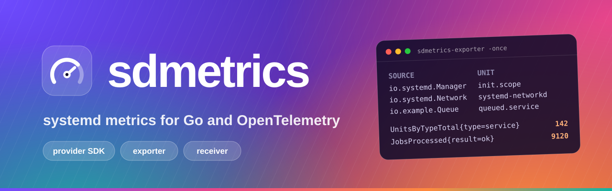
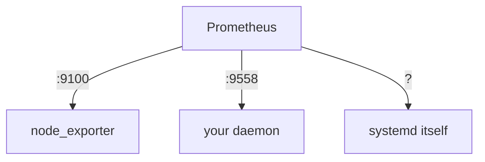
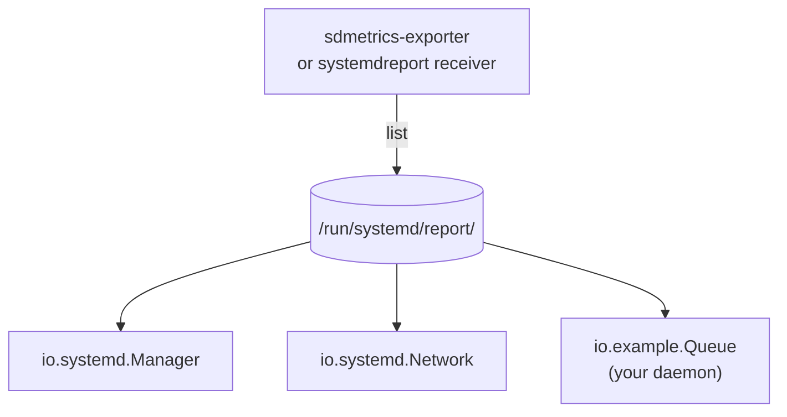

<div class="sd-hero" markdown>



<h1 class="sd-visually-hidden">sdmetrics</h1>

<div class="sd-hero__body" markdown>

<p class="sd-hero__lead">
<strong>systemd v260 gave every service a standard place to publish metrics. sdmetrics connects it to Go and OpenTelemetry.</strong>
Publish your daemon's metrics under <code>/run/systemd/report/</code> in a few lines, then export every source on the
host, systemd's own included, as OTLP or Prometheus, each attributed to the unit that produced it. Pure Go, no cgo.
</p>

<p class="sd-hero__actions">
<a class="md-button md-button--primary" href="getting-started/quickstart-provider/">Get started</a>
<a class="md-button" href="https://github.com/rossedman/sdmetrics">View on GitHub</a>
</p>

<div class="sd-hero__install">go get github.com/rossedman/sdmetrics@latest</div>

</div>
</div>

## Thirty seconds of sdmetrics { #thirty-seconds }

=== "Publish metrics"

    ```go
    package main

    import (
        "context"
        "log"
        "os"
        "os/signal"

        "github.com/rossedman/sdmetrics/provider"
    )

    func main() {
        p, err := provider.New("io.example.Queue") // (1)!
        if err != nil {
            log.Fatal(err)
        }
        depth := p.Gauge("Depth", provider.Help("Jobs waiting"))
        jobs := p.Counter("JobsProcessed", provider.Labels("result")) // (2)!

        depth.Set(42)
        jobs.With("ok").Inc()

        ctx, stop := signal.NotifyContext(context.Background(), os.Interrupt)
        defer stop()
        if err := p.Serve(ctx); err != nil { // (3)!
            log.Fatal(err)
        }
    }
    ```

    1.  The provider name is the socket's file name:
        `/run/systemd/report/io.example.Queue`. Families are published as
        `io.example.Queue.Depth` and `io.example.Queue.JobsProcessed`.
    2.  Labels become the `fields` of each value. Updates are atomic and do
        not allocate.
    3.  `Serve` binds the socket (mode `0660`), answers `io.systemd.Metrics`
        and removes the socket when the context ends.

=== "Read it with systemd"

    ```console
    $ systemd-report metrics io.example.Queue
    $ varlinkctl call --more /run/systemd/report/io.example.Queue io.systemd.Metrics.List '{}'
    ```

    Your daemon is now a report source like `io.systemd.Manager`. Anything
    that reads systemd's report framework reads it too.

=== "Export the host"

    ```sh
    # Print every source once, with the unit that owns it.
    sdmetrics-exporter -once

    # Push OTLP to a collector and serve Prometheus.
    sdmetrics-exporter -otlp.endpoint otel-gateway:4317 -otlp.insecure \
                       -prometheus.listen 127.0.0.1:9558 -naming otel
    ```

=== "In the Collector"

    ```yaml
    receivers:
      systemdreport:
        collection_interval: 30s
        naming: otel

    service:
      pipelines:
        metrics:
          receivers: [systemdreport]
          exporters: [otlp]
    ```

=== "Scrape from Go"

    ```go
    s := scrape.New(scrape.Options{})
    res, err := s.Scrape(ctx)
    if err != nil {
        return err // scrape.ErrNoReportDir before systemd v260
    }
    for _, src := range res.Sources {
        fmt.Println(src.Name, src.Unit, len(src.Families), src.Err)
    }
    ```

<div class="sd-stats" markdown>
<div class="sd-stat"><b>~27 ms</b><span>to scrape 50 sources, 5,000 values</span></div>
<div class="sd-stat"><b>~38 ns</b><span>per Gauge.Set, 0 allocations</span></div>
<div class="sd-stat"><b>1.5</b><span>systemd-analyze security score of the packaged unit</span></div>
<div class="sd-stat"><b>3</b><span>ways out: OTLP · Prometheus · Collector</span></div>
<div class="sd-stat"><b>0</b><span>cgo, agents or D-Bus</span></div>
</div>

## What you get { #features }

<div class="grid cards" markdown>

-   :material-gauge:{ .lg .middle } **A provider SDK**

    ---

    Gauges, counters and string metrics with labels and objects, served as
    `io.systemd.Metrics` on a report socket. Lock-free, allocation-free
    updates.

    [:octicons-arrow-right-24: Provider SDK](guides/provider.md)

-   :material-bridge:{ .lg .middle } **Bridges for existing code**

    ---

    Already instrumented? Publish a Prometheus registry or an OpenTelemetry
    SDK reader through a provider in two lines.

    [:octicons-arrow-right-24: Prometheus](guides/prometheus-bridge.md) ·
    [:octicons-arrow-right-24: OpenTelemetry](guides/otel-bridge.md)

-   :material-export:{ .lg .middle } **A host exporter**

    ---

    `sdmetrics-exporter` scrapes every source on an interval and pushes OTLP,
    serves `/metrics`, or both. Shipped as deb and rpm with a hardened unit.

    [:octicons-arrow-right-24: Exporter](exporter/index.md)

-   :material-transit-connection-variant:{ .lg .middle } **A Collector receiver**

    ---

    `systemdreport` brings the same scrape into the OpenTelemetry Collector,
    built with `mdatagen` and `scraperhelper`.

    [:octicons-arrow-right-24: Receiver](receiver/index.md)

-   :material-card-account-details-outline:{ .lg .middle } **Unit identity**

    ---

    Every source is attributed to its systemd unit, from peer credentials
    and cgroups, or from the manager for socket-activated sources.

    [:octicons-arrow-right-24: Unit identity](guides/unit-identity.md)

-   :material-map-outline:{ .lg .middle } **A documented OTel mapping**

    ---

    One resource per source, `service.name` from the unit, counters with
    proper start times, and an optional OTel naming mode.

    [:octicons-arrow-right-24: Mapping](reference/otel-mapping.md)

</div>

## Why systemd's report framework? { #why-report }

Before v260, every daemon that wanted metrics opened its own HTTP port, picked
its own names and left you to work out which service a port belonged to.
systemd v260 adds a **report framework**: a service serves the
`io.systemd.Metrics` Varlink interface on a socket under `/run/systemd/report/`,
and any consumer lists the directory to find every source on the host.

<div class="sd-compare" markdown>
<div markdown>

#### :material-lan-pending: Before: a port per daemon



</div>
<div markdown>

#### :material-folder-network-outline: After: one directory per host



</div>
</div>

No ports, no service discovery, and identity for free: the socket's peer
credentials tell the scraper which unit answers. Learn the model in
[Core concepts](getting-started/concepts.md).

<div class="grid cards" markdown>

-   :material-rocket-launch-outline:{ .lg .middle } **Publishing from Go?**

    ---

    A working provider in ten lines, read back with `systemd-report`.

    [:octicons-arrow-right-24: Quickstart: publish metrics](getting-started/quickstart-provider.md)

-   :material-server-outline:{ .lg .middle } **Operating hosts?**

    ---

    Install the exporter and see every source on the host in a minute.

    [:octicons-arrow-right-24: Quickstart: export a host](getting-started/quickstart-exporter.md)

-   :material-book-open-variant:{ .lg .middle } **Looking something up?**

    ---

    Every config key, metric name and attribute, with its default.

    [:octicons-arrow-right-24: Reference](reference/index.md)

</div>
