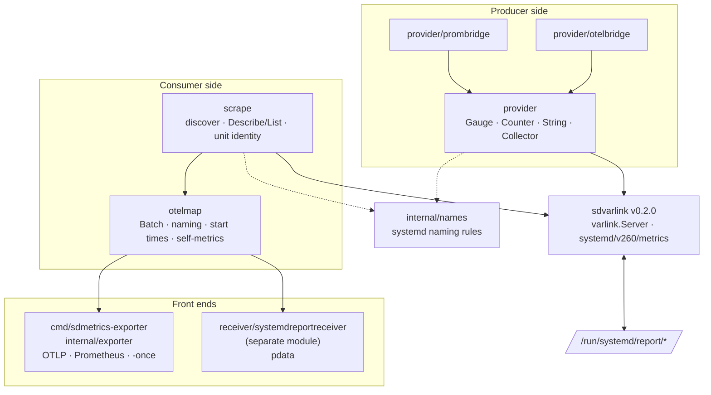

# Architecture

sdmetrics has a **producer side** (the provider SDK and its bridges), a
**consumer side** (the scraper and the OpenTelemetry mapper), and two
**front ends** built on the consumer side: the exporter and the Collector
receiver. Both sides speak Varlink through
[sdvarlink](https://rossedman.github.io/sdvarlink/), and meet only at the
socket.

## Packages



| Package | Responsibilities |
| --- | --- |
| `provider` | Name validation, metric families and series (atomics, copy-on-write indexes), `Collector`, binding or adopting the socket, serving `io.systemd.Metrics` with `varlink.Server`. |
| `provider/prombridge`, `provider/otelbridge` | Convert a Prometheus `Gatherer` or an OTel SDK `Reader` into `provider.Family` values on each read. |
| `scrape` | List the report directory, call each source concurrently with a timeout, decode values, apply systemd's rules and count drops, resolve units from `SO_PEERCRED` and cgroups, and ask the manager about socket-activated sources. |
| `otelmap` | Map a `scrape.Result` to a neutral `Batch`: resources, attributes, names, counter start times, self-metrics. `ToSDK` converts for the Go SDK. |
| `internal/names` | The naming rules, shared by both sides so they can't disagree. |
| `internal/exporter`, `cmd/sdmetrics-exporter` | Configuration, the scrape loop, OTLP push, the Prometheus collector, `-once` printing. |
| `receiver/systemdreportreceiver` | Collector factory, config and scraper; converts a `Batch` to `pdata`. |

## A scrape, end to end

```mermaid
sequenceDiagram
    autonumber
    participant E as exporter / receiver
    participant S as scrape.Scraper
    participant Src as /run/systemd/report/X
    participant Pr as /proc/PID/cgroup
    participant Mgr as io.systemd.Manager
    participant M as otelmap.Mapper
    E->>S: Scrape(ctx)
    S->>S: ReadDir, filter names and include/exclude
    par up to 8 sources at once, 2 s each
        S->>Src: connect; SO_PEERCRED
        S->>Pr: read cgroup → innermost unit
        S->>Src: io.systemd.Metrics.Describe (more)
        S->>Src: io.systemd.Metrics.List (more)
    end
    opt sources whose peer is PID 1
        S->>Mgr: io.systemd.Unit.List (cached ~5 min)
    end
    S-->>E: Result
    E->>M: Map(result)
    M-->>E: Batch: a resource per source + self-metrics
    E->>E: OTLP Export per resource · store for /metrics · or pdata
```

## Two modules

The repository holds two Go modules:

| Module | Contains | Tags |
| --- | --- | --- |
| `github.com/rossedman/sdmetrics` | `provider`, bridges, `scrape`, `otelmap`, the exporter | `vX.Y.Z` |
| `github.com/rossedman/sdmetrics/receiver/systemdreportreceiver` | the Collector receiver | `receiver/systemdreportreceiver/vX.Y.Z` |

The split keeps the Collector's large dependency tree out of programs that
only publish metrics. The receiver's code is generated in part by `mdatagen`
from `metadata.yaml`; CI checks it is fresh.

## Testing layers

| Layer | What | When |
| --- | --- | --- |
| Unit | Providers served on temp directories and scraped back, naming rules, value decoding, unit resolution with a fake `/proc`, the mapper, the exporter against an in-memory OTLP sink, receiver golden files | Every push and PR, Go stable and oldstable, amd64 and arm64, with `-race` |
| Coverage | At least 90% of statements in each module (examples excluded) | Every push and PR |
| Fuzz | Value decoder, name sanitizer | Seeds on every PR; 10 minutes each nightly |
| Benchmarks | `BenchmarkScrape200`, provider hot paths; medians of 10 runs vs the base branch, fail on >25% regression (`hack/benchgate`) | Every PR |
| Integration | Real systemd as PID 1 in `fedora:rawhide` and `archlinux:latest`: systemd's sources, the sample daemon as a service and socket-activated, `systemd-report`, the exporter, the packaged unit | Every push and PR, nightly |
| Build | `linux/amd64` and `linux/arm64`, `CGO_ENABLED=0`, both modules | Every push and PR |

More background in [Design decisions](design.md).
