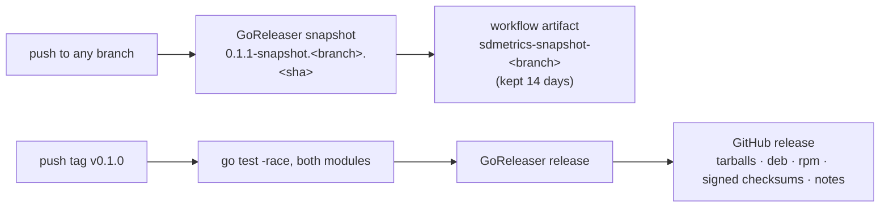

# Releases

sdmetrics is two Go modules and one binary. You get the libraries with
`go get`, the receiver with `go get` or ocb, and the exporter as prebuilt
packages built by [GoReleaser](https://goreleaser.com).

```sh
go get github.com/rossedman/sdmetrics@latest                                   # the libraries
go get github.com/rossedman/sdmetrics/receiver/systemdreportreceiver@latest    # the receiver
go install github.com/rossedman/sdmetrics/cmd/sdmetrics-exporter@latest        # or build the exporter yourself
```

## What gets versioned how

| Part | Tag | Versioning |
| --- | --- | --- |
| `provider`, bridges, `scrape`, `otelmap`, `sdmetrics-exporter` | `vX.Y.Z` | [Semantic versioning](https://semver.org/). Before v1.0, minor releases may change APIs; the changelog says how. |
| `systemdreportreceiver` | `receiver/systemdreportreceiver/vX.Y.Z` | Versioned with the root module (same version number), tagged after it; Collector stability alpha. |

## Release flow



### Snapshots on every branch

Every push to any branch builds a snapshot with the same configuration as a
real release. Download it from the workflow run: **Actions → Release**, the
run for your branch, artifact **`sdmetrics-snapshot-<branch>`**. It contains
the tarballs, deb and rpm packages and `checksums.txt`; the run summary lists
the checksums. Snapshot versions name the branch and commit, for example
`0.1.1-snapshot.feat-receiver.a1b2c3d`, and `sdmetrics-exporter -version`
prints it.

### Tagged releases

Pushing a `v*` tag runs both modules' tests with the race detector, then
publishes a GitHub release with:

- `sdmetrics-exporter` for Linux on amd64 and arm64, as `tar.gz` archives
  (with `README.md`, `LICENSE`, `CHANGELOG.md`, the unit, the sysusers.d file
  and `exporter.yaml`) and as deb and rpm packages that install them;
- `checksums.txt` (SHA-256), signed keylessly with cosign
  (`checksums.txt.sigstore.json`), and a build provenance attestation;
- release notes grouped by commit prefix: Features (`feat:`), Bug fixes
  (`fix:`), Performance (`perf:`), Other changes.

Tags with a pre-release suffix, such as `v0.2.0-rc.1`, are marked as
pre-releases.

The receiver module needs no release assets: tagging
`receiver/systemdreportreceiver/vX.Y.Z` is all Go modules and ocb need.

## Verifying downloads

Releases that ship `checksums.txt.sigstore.json` are signed with
[cosign](https://docs.sigstore.dev/) and carry GitHub build provenance. Download the assets you need with `checksums.txt` and its
bundle, then:

```sh
# Every archive and package is listed in checksums.txt, which is signed
# keylessly by the release workflow.
cosign verify-blob checksums.txt \
  --bundle checksums.txt.sigstore.json \
  --certificate-identity-regexp '^https://github.com/rossedman/sdmetrics/.github/workflows/release.yml@refs/tags/v' \
  --certificate-oidc-issuer https://token.actions.githubusercontent.com
sha256sum --check --ignore-missing checksums.txt
gh attestation verify sdmetrics-exporter_*_linux_amd64.tar.gz --repo rossedman/sdmetrics
```

## Cutting a release (maintainers)

```sh
make release-check            # validate .goreleaser.yaml
make snapshot                 # build dist/ locally, exactly as CI does
git tag -a v0.1.0 -m "v0.1.0" && git push origin v0.1.0
# then: require github.com/rossedman/sdmetrics v0.1.0 in the receiver's go.mod, commit
git tag -a receiver/systemdreportreceiver/v0.1.0 -m "receiver v0.1.0"
git push origin receiver/systemdreportreceiver/v0.1.0
```

Update `CHANGELOG.md` before tagging. Tag the root module first, then point
the receiver's `require github.com/rossedman/sdmetrics` at that version
before tagging the receiver: its development `replace` directive does not
apply to modules that depend on it. See [Contributing](contributing.md) for the rest of the workflow.
