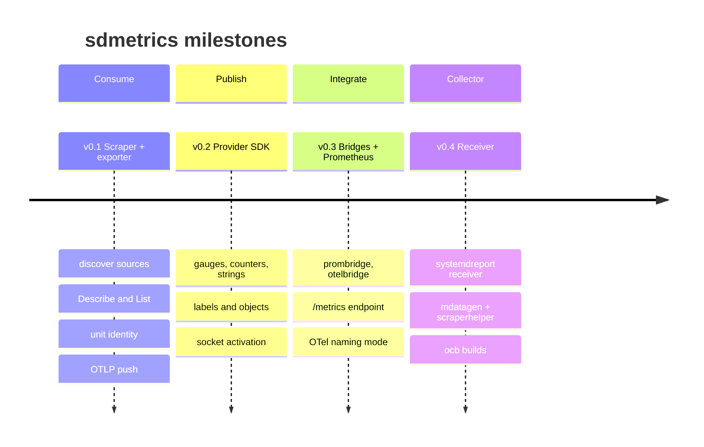

# Roadmap

sdmetrics was planned in four milestones, each with a **gate**: a concrete
check against real systemd. All four are implemented in the initial release,
and the gates run in CI on every change as integration tests.

## Milestones and gates

| Milestone | Scope | Gate | Status |
| --- | --- | --- | --- |
| **v0.1 Scraper and exporter** | `scrape`, `otelmap`, `sdmetrics-exporter` with OTLP, `-once`, the packaged unit. | systemd's own sources scrape with correct types and identity (`TestSystemdSources`), and the exporter delivers them to an OTLP sink (`TestExporterToOTLP`). | :material-check: done |
| **v0.2 Provider SDK** | `provider`: metric types, labels, objects, callbacks, collectors, socket options, `FromActivation`. | The sample daemon, run as a service, shows up in `systemd-report` and the scraper, attributed to its unit (`TestSampleDaemon`); socket-activated too (`TestSocketActivated`). | :material-check: done |
| **v0.3 Bridges and Prometheus** | `prombridge`, `otelbridge`, the Prometheus endpoint, `naming: otel`. | Round-trip tests through a provider for both bridges (`TestRoundTrip`); the endpoint serves both naming modes (`TestPrometheusRaw`, `TestPrometheusOTelNaming`). | :material-check: done |
| **v0.4 Receiver** | `systemdreportreceiver` with `mdatagen`, `scraperhelper`, golden files. | The generated lifecycle tests and the golden-file test (`TestScrapeGolden`) pass against Collector v0.163.0 / v1.69.0. | :material-check: done |

### Gate checklist

- [x] systemd's own sources scrape on v262 with every value typed (no drops from the manager).
- [x] The sample daemon is attributed to its unit, as a service and socket-activated.
- [x] `systemd-report` reads a Go provider.
- [x] The packaged unit starts, serves `/metrics`, and scores 1.5 in `systemd-analyze security`.
- [x] 50 sources and 5,000 values scrape in well under a second (about 27 ms).
- [x] Provider updates don't allocate.
- [x] CI fails on benchmark regressions over 25%.

## Follow-ups { #follow-ups }

-   :material-code-json:{ .lg .middle } **The `object` family type**

    ---

    systemd v262 added an `object` type, and journald uses it. Today those
    values are dropped and counted (`sdmetrics.metrics.dropped`,
    `reason="untyped"`). Next: decode them and decide on a mapping, likely
    flattening members into attributes or separate metrics.

-   :material-book-check-outline:{ .lg .middle } **Semantic conventions**

    ---

    Propose `systemd.report.source`, `systemd.unit.name`, `systemd.object` and
    `systemd.value` to OpenTelemetry semantic conventions, so the mapping
    stops being sdmetrics-specific.

-   :material-source-pull:{ .lg .middle } **Upstream the receiver**

    ---

    Propose `systemdreportreceiver` to `opentelemetry-collector-contrib`. It
    already follows contrib's layout: `metadata.yaml`, `mdatagen`,
    `scraperhelper`, golden tests.

-   :material-file-sign:{ .lg .middle } **Signed report forwarding**

    ---

    systemd v262 adds `io.systemd.Report.SignPlain`. Explore forwarding
    signed reports, so a backend can verify which host produced them.

## Out of scope

Replacing node_exporter or the Collector's host metrics, storing or querying
metrics, remote transports, and systemd older than v260. See
[Design decisions](design.md#goals-and-non-goals).

Have a use case that doesn't fit?
[Open an issue](https://github.com/rossedman/sdmetrics/issues/new/choose).
